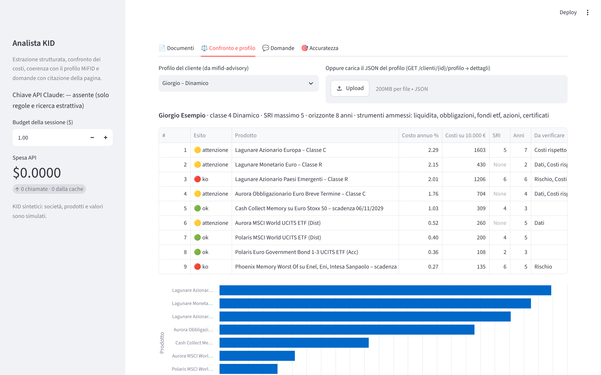
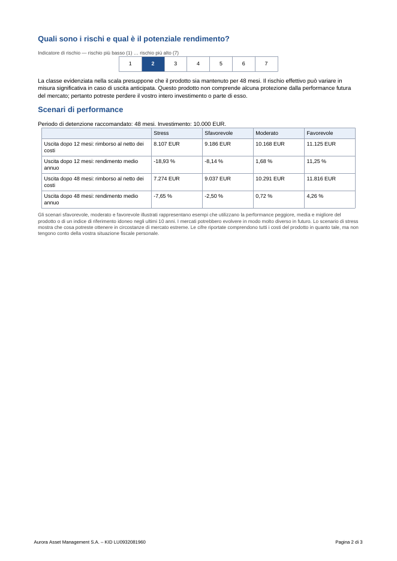
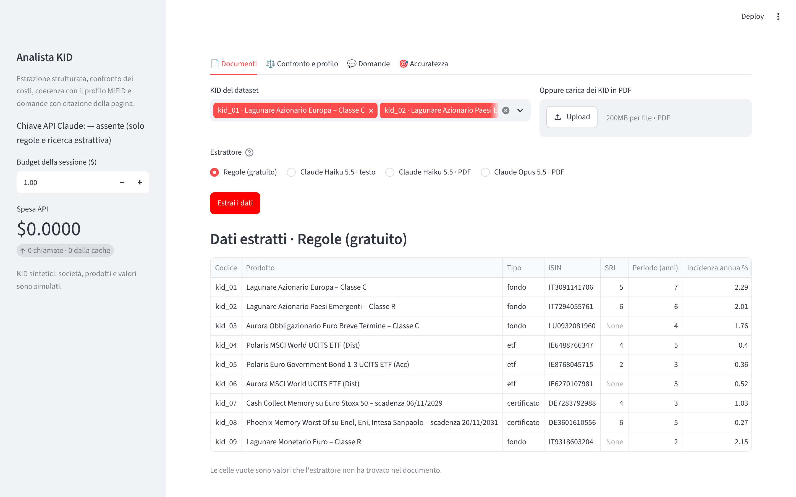
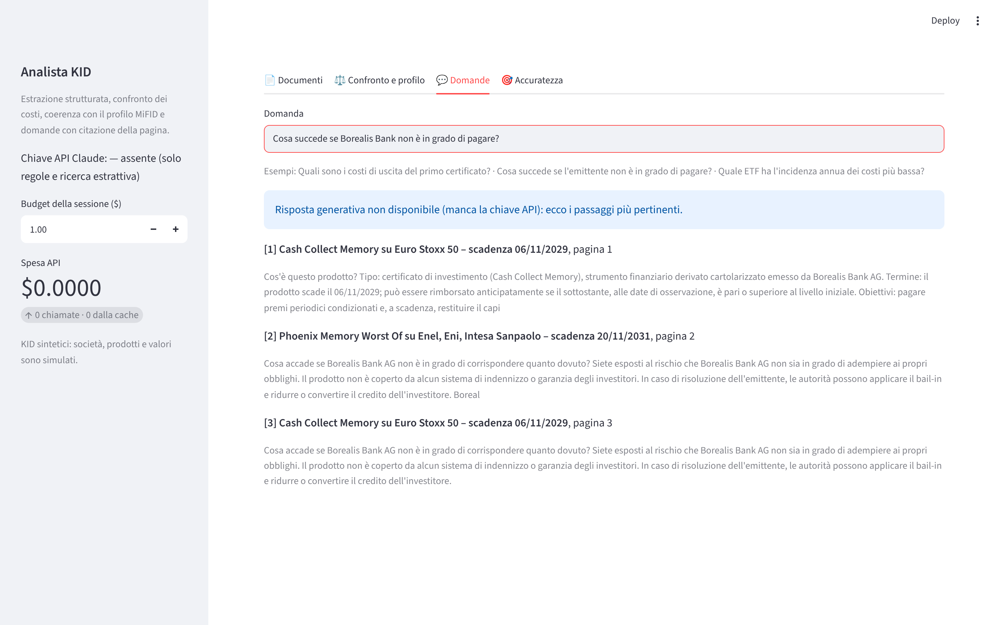
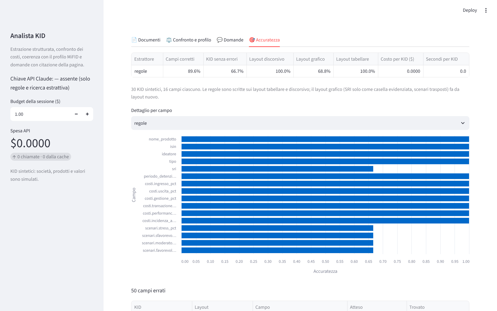

# Analista AI di KID PRIIPs

Legge i KID (documenti contenenti le informazioni chiave) di fondi, ETF e certificati, ne estrae i dati in forma
strutturata con Claude, confronta i costi dei prodotti, segnala quelli incoerenti con il profilo MiFID del cliente e
risponde a domande in linguaggio naturale citando documento e pagina. Ogni affermazione sull'accuratezza è misurata
su un dataset con valori di riferimento noti.

È il quinto progetto della serie su finanza e investimenti in Python e si collega al quarto,
[mifid-advisory](https://github.com/Torraf-MI/mifid-advisory): i profili dei clienti arrivano dalla sua API.



## Che cosa fa

| Funzione | Come |
|---|---|
| **Estrazione strutturata** | Claude legge il PDF e restituisce un oggetto Pydantic validato (`messages.parse` con output strutturato): nome, ISIN, ideatore, tipo, SRI, periodo di detenzione raccomandato, sei voci di costo, quattro scenari di performance |
| **Due modalità di input** | `pdf` (il documento intero: Claude vede anche la grafica) e `testo` (solo il testo estratto, meno token) |
| **Baseline a regole** | Espressioni regolari, gratuite e deterministiche, come termine di paragone |
| **Domande con citazioni** | Ricerca BM25 sulle sezioni dei KID, risposta di Claude con le citazioni attive: ogni frase porta il testo citato, il documento e la pagina. Senza chiave API, risposta estrattiva |
| **Confronto e coerenza** | Classifica per incidenza annua dei costi, segnala i prodotti molto più cari della mediana del loro tipo e controlla SRI, orizzonte, conoscenza ed esperienza e costi rispetto al profilo MiFID |
| **Controllo dei costi API** | Stima preventiva con il conteggio dei token, budget rigido per sessione, cache su disco dei risultati, spesa reale letta da `usage` |
| **Valutazione** | Accuratezza per campo, per impaginazione e per documento, con costo e tempo per KID |

## Il dataset di valutazione

Trenta KID sintetici (`dataset/kid/`) generati con reportlab secondo lo schema del Regolamento delegato 2017/653,
con i valori attesi in `dataset/attesi/`. Società e prodotti sono inventati e i valori sono coerenti fra loro
(l'incidenza annua dei costi deriva dalle singole voci). Ho controllato a vista un campione di PDF di ogni
impaginazione rispetto ai valori attesi; il test `test_dataset_versionato_riproducibile` garantisce che il generatore
riproduca esattamente i file versionati.

I KID usano tre impaginazioni, come capita leggendo documenti di case diverse:

* **tabellare**: tabelle standard, SRI scritto nel testo, periodo in anni;
* **discorsivo**: costi descritti in prosa ("pari allo 0,88%"), scenari in ordine inverso;
* **grafico**: SRI indicato solo dalla casella evidenziata della scala, periodo in mesi, scenari trasposti, "Nessuno"
  al posto dello zero.



Le regole sono state scritte guardando solo le prime due impaginazioni: la terza fa da layout mai visto.

## Risultati

16 campi per KID, 480 in tutto. Un numero è corretto entro 0,01 punti percentuali; un valore mancante conta come
errore.

| Estrattore | Campi corretti | KID senza errori | discorsivo | grafico | tabellare | Costo per KID |
|---|---:|---:|---:|---:|---:|---:|
| regole | 89,6% | 66,7% | 100,0% | 68,8% | 100,0% | $0 |

Le regole sono perfette sui layout per cui sono state scritte e crollano sul layout nuovo: non trovano né l'SRI
grafico né gli scenari trasposti. È il problema che un modello linguistico dovrebbe risolvere, e la valutazione con
Claude lo misura (workflow **Valutazione con Claude**, vedi sotto). I risultati di Claude sono in `risultati/` dopo
la prima esecuzione: in questo README compaiono solo numeri misurati.

## Avvio

```bash
pip install -e ".[app,dev]"
export ANTHROPIC_API_KEY=...        # facoltativa: senza, funzionano regole e ricerca estrattiva
streamlit run src/kid_analyst/app.py
```

Riga di comando:

```bash
kid-analyst estrai dataset/kid/kid_03.pdf --motore claude-opus-5-5:pdf:low
kid-analyst confronta dataset/kid/*.pdf --profilo dataset/profili/giorgio.json
kid-analyst chiedi "Cosa succede se Borealis Bank non è in grado di pagare?"
kid-analyst valuta --budget 5          # regole e, con la chiave, tre configurazioni di Claude
kid-analyst genera                     # rigenera il dataset
```

Il profilo può arrivare anche direttamente da mifid-advisory in esecuzione:

```bash
kid-analyst confronta dataset/kid/*.pdf --mifid-url http://localhost:8000 --cliente 2
```

## Valutazione con Claude su GitHub Actions

1. Settings → Secrets and variables → Actions → New repository secret: `ANTHROPIC_API_KEY`.
2. Actions → **Valutazione con Claude** → Run workflow (budget predefinito 5 dollari).

Il workflow valuta Claude Haiku 5.5 (testo e PDF) e Claude Opus 5.5 (PDF), scrive la tabella nel riepilogo
dell'esecuzione e salva i risultati in `risultati/`. Ogni chiamata viene stimata prima di partire e rifiutata se
potrebbe superare il budget.

## Schermate

| | |
|---|---|
|  |  |
|  |  |

## Struttura

```
src/kid_analyst/
  schema.py              modello Pydantic del KID (schema dell'output strutturato)
  generatore.py          KID sintetici in tre impaginazioni e valori attesi
  pdf.py                 testo pagina per pagina con pdfplumber
  estrattore_regole.py   baseline a espressioni regolari
  estrattore_claude.py   estrazione con Claude, modalità pdf e testo
  costi_api.py           prezzi, budget, cache su disco
  rag.py                 ricerca BM25 e risposte con citazioni
  confronto.py           classifica dei costi e coerenza con il profilo MiFID
  valutazione.py         metriche di accuratezza
  app.py, cli.py         interfaccia Streamlit e riga di comando
tests/                   27 test; le chiamate a Claude passano dal vero SDK su un trasporto simulato
```

I test verificano il formato esatto delle richieste (blocco documento PDF, schema JSON, effort, citazioni) senza
rete e senza costi.

## Limiti

* I KID sono sintetici: le impaginazioni reali sono più varie e i numeri su documenti veri vanno misurati a parte.
* I controlli di coerenza sono un primo filtro per il consulente, non la verifica di adeguatezza completa, che resta
  quella di mifid-advisory sul portafoglio.
* Il progetto non dà consigli di investimento.
